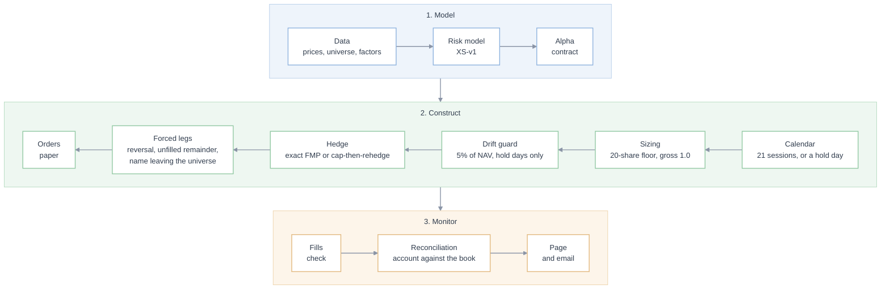

# Equity Factor Book (EFB)

A systematic long/short S&P 500 book, built from free data and run as a **paper**
account: the risk model, the hedge, the sizing, the cost model, the order path and the
attribution are all here and all running on a cron. It trades `idio_momentum`, a signal
that failed its own gate, so the book is a **measurement instrument** rather than an
edge claim: the point is to watch a real stack behave on a signal whose expected verdict
was written down before it traded.

**The live page: <https://efb-live-book.nutritrack.workers.dev>** (public, paper account,
no login).

[](https://efb-live-book.nutritrack.workers.dev)

Screenshot from the 2026-10-23 close; the live page updates every evening.

## At a glance

- **Universe:** point-in-time S&P 500, rebuilt by walking the index changes table
  backwards. Survivorship is measured, not hidden: buying today's members and assuming
  they were always members earns **359.58 bp a year** more than the investable universe.
- **Risk model:** `XS-v1`, seven style factors and eleven sectors, fitted daily by WLS
  from January 2011, with a shrunk specific variance and a factor covariance.
  Cross-sectional R squared averages 0.3295.
- **Signal:** `idio_momentum`. Raw horizon-1 IC **0.0125** (t 5.22); factor-neutral
  **-0.0045** (t -0.77). All six candidates returned NULL at the signal gate.
- **Construction:** 20 whole-share floor, gross 1.0, any single position capped at 0.10
  of NAV, and an exact factor-mimicking-portfolio hedge in `cap_then_rehedge` mode.
- **Cadence:** a rebalance every **21 sessions** (anchored 2026-10-23, next 2026-11-23)
  with **hold days** between, and a **5% drift guard** that re-hedges a hold day when the
  worst factor exposure is past the threshold.
- **Costs:** 86.7 bp a year of trading cost at 13.15 turns, plus borrow at 0.35%. Nightly
  rebalancing costs 624.6 bp and nets negative.
- **Status:** paper only, about $982k of NAV, 92 long and 104 short names on the
  2026-10-23 book, running on Render's cron with an automated morning reconciliation.

## How it works



**The evening run**, 22:30 UTC. It extends the price panel, fits the model, builds the
target book, hedges it, sizes it under the position cap and the $250 order minimum, reads
the account, sends paper market orders and writes the snapshot the page reads. It refuses
to trade if the account it reached is not the one the account id names, and it refuses
outside 16:00-20:00 New York unless the hour is forced.

**The morning**, 15:30 UTC. It reconciles the fills against what the account now holds,
rewrites the account block, and says in one line whether the book is where the run said
it would be. The two jobs share one cron service and are routed by the New York hour
([`render.yaml`](render.yaml), `scripts/run_cron.py`).

**Hold days.** A hold day publishes the book the account holds and sends only what the
last rebalance left owing: a reversal's second leg, a partial fill or a rejection, a name
that left the universe, a name with no usable close or no risk estimate, a short the
broker will not lend, and the guard's own re-hedge
([`docs/cadence_flag.md`](docs/cadence_flag.md)).

**The guard.** On a hold day the worst factor exposure is measured against the design the
book will be held with, after the forced legs are placed. Past 5% of NAV the book takes
the minimum-norm correction that re-neutralizes it, under `cap_then_rehedge`. The guard
fires on 24% of hold days, costs 23.8 bp a year, and buys a p95 worst exposure of 4.76%
against 21.71% for the same cadence with no guard
([`docs/research/daily_design_study.md`](docs/research/daily_design_study.md)).

## What it costs, and why it rebalances monthly

| cadence | turnover a year | trading cost a year | net at the 169 bp anchor |
|---|---|---|---|
| every session | 97.53 turns | 624.6 bp | -473.2 bp |
| every 21 sessions | 9.43 turns | 62.4 bp | +89.0 bp |
| every 21 sessions + the 5% guard (live) | 13.15 turns | 86.7 bp | +64.7 bp |

The net column is the study's own restatement, `169 - cost - borrow`, with borrow at
0.35% on a book that is 50.4% short gross (17.6 bp a year). Nightly rebalancing turns the
book over 38.70% of NAV a night, which is what makes it the whole cost
([`docs/research/daily_design_study.md`](docs/research/daily_design_study.md),
[`docs/borrow_rate.md`](docs/borrow_rate.md)).

**Borrow is 0.35% a year**, not a placeholder: general collateral prices at 10 to 35 bp,
Alpaca charges nothing on easy-to-borrow names, and 35 bp sits above the general
collateral point estimate to carry the hard-to-borrow tail a single rate cannot see. Every
short on the account reads `easy_to_borrow`, so the realised bill is zero and the 0.35% is
a stress input ([`docs/borrow_rate.md`](docs/borrow_rate.md)).

**The execution cost measured on paper is not a real cost estimate.** Fills pay 17.2 bp
against the open over twelve filled days, all of it on the buy side, but paper orders are
matched at the best available quote with the size never checked, so the number measures
this venue's simulator rather than an equity book
([`docs/research/exec_timing.md`](docs/research/exec_timing.md)).

## Attribution

The second tab splits the book's P&L into the four terms that add to it: the hedge's factor
P&L, the names' idiosyncratic P&L, the cost contribution, and the unexplained remainder.
Below them are the cumulative and daily charts, then the predicted volatility before and
after the hedge and a realized-against-forecast panel that refuses to draw a verdict on
fewer than thirty live sessions.

[](https://efb-live-book.nutritrack.workers.dev)

Every row is stored by the evening run and the page recomputes the identity from them, so
a day that does not add up shows as a gap between a bar and its marker
([`docs/research/E12_attribution_report.md`](docs/research/E12_attribution_report.md)).

## What running it live taught

| when | what happened | the fix | where |
|---|---|---|---|
| pre-launch | The alpha formula multiplied a **variance where its contract says volatility**, tilting the book to whichever names moved most; every sign-only test passed either way. | Multiply the square root, and test the value rather than the ranking. | [`E11`](docs/research/E11_live_launch.md) |
| pre-launch | **Broker fields arrived as text**, not as the enumerations the code compares against. | Parse into the enumeration at the boundary and refuse a value nothing recognizes. | [`E11`](docs/research/E11_live_launch.md) |
| 2026-10-14 | A **warrant in the SPY file** (`SKYD/WS`) was asked for alone, came back empty, and the frame builder assumed its columns existed, so the evening stopped before sizing. | An empty or partial download returns a correctly shaped frame, and the name is dropped with its reason. | [`incident`](docs/incident_2026-10-14.md) |
| 2026-10-15 | The same warrant was **read as a spin-off child**, replacing SKYD's real -23.84% print with +3.13%; the name was already excluded so no position moved. | A warrant, unit or right line is never a spin-off child. | [`incident`](docs/incident_2026-10-15_skyd_spinoff.md) |
| 2026-10-16 | The **pre-hedge reconstruction sized on volatility** where the contract says variance, so the "before the hedge" volatility was a number no run ever had. | Square before sizing, and restate the stored rows. | [`disposition`](docs/nov11_disposition.md) |
| 2026-10-22 | **Realized volatility was measured over the batch** a run happened to hold, giving a tenfold cliff (0.226% against 2.477%). | The window runs over the book's own history, and a repair script restates the series. | [`cadence`](docs/turn_on_monthly.md) |
| 2026-10-22 | The **cost estimate priced the whole book** instead of the trades, so it sat flat at 14.3 bp whatever traded. | Spread, commission and impact charge the traded notional; only borrow stays on the book. | [`cadence`](docs/turn_on_monthly.md) |
| 2026-10-22 | Under a monthly cadence a **reversal's second leg was never sent**, because a hold day publishes the account's flat book. | A hold day forces whatever the last rebalance left owing. | [`cadence`](docs/cadence_flag.md) |
| 2026-10-01 | The vendor served CTVA's **spin-off as a price** (77.65 to 12.57, a 6.7x restatement), and the cross check refuses a back-adjustment no split record explains, so the run would stop rather than trade a return it cannot reproduce. | Mask the cell and refit the session; the owner's contract then excludes that name for the night, records its ratio and names it in the email. | [`ledger`](docs/hygiene_ledger.md), [`monday`](docs/monday_2026-10-26.md) |

Each one is a defect the code could not see from the inside: every unit test held the
world still, and every failure lived in a seam between two things that were each right.

## The research behind it

| stage | what it settled |
|---|---|
| [E1](docs/research/E1_data_note.md) | A return, a universe and a risk-free rate that can be defended: the survivorship gap is 359.58 bp a year, 40.96% of deleted members have recoverable history, and the equal-weight universe tracks the French market at 0.9573. |
| [E2](docs/research/E3_factor_model_note.md) | Time-series betas and volatility: a shrunk rolling beta with Newey-West errors, production on a 0.97 decay estimate. |
| [E3](docs/research/E3_factor_model_note.md) | `XS-v1`: seven styles and eleven sectors, cross-sectional R squared 0.3295, factor-mimicking portfolios exact to 1e-13. |
| [E4](docs/research/E4_covariance_memo.md) | Nine covariance estimators raced; the specific returns still carry common structure, with the largest residual eigenvalue 22.303 against a 3.952 edge. |
| [E5](docs/research/E5_risk_model_diagnostic.md) | No version is calibrated: the champion is provisional and carries a stored stress haircut of 1.8401. |
| [E6](docs/research/E6_hedge_study.md) | The exact FMP hedge takes the worst post-hedge exposure to 5.8e-15 and trades 461.9 names a rebalance; the ETF alternative removes 0.978494 of factor variance with 13 instruments. |
| [E7](docs/research/E7_signal_idio_momentum.md) | Six signals, all NULL once the factors are removed; the book runs the best-behaved of them as a documented null. |
| [E8](docs/research/E8_construction_memo.md) | Construction on synthetic alpha with a known IC: breadth is the name count, and the hedged rules realize IC times its square root. |
| [E9](docs/research/E9_tcost_capacity.md) | Equity costs cannot be measured on free data, so the cost model is a stated assumption and capacity is undefined for a synthetic alpha. |
| [E10](docs/research/E10_risk_policy.md) | A risk allocation and drawdown policy at the configuration whose net Sharpe is closest to 1.0, scaled to a 10% volatility target. |
| [E11](docs/research/E11_live_launch.md) | Taking it live: the pre-flip gate, the smoke orders, and the defects the review caught first. |
| [E12](docs/research/E12_attribution_report.md) | P&L attribution whose identity closes, on 3,645 stored sessions; the live book replaces the input table and nothing else. |
| [E13](docs/credit_port_design.md) | What ports to a corporate credit book unchanged, what has to be re-specified, and where unchanged is the wrong answer. |

## Running it

```bash
python3.14 -m venv .venv
source .venv/bin/activate
pip install -e ".[dev]"
pre-commit install
```

| command | what it does |
|---|---|
| `make test` | the fast suite: no network, no full evening job |
| `make lint` | ruff, mypy and black over the package, the page and the scripts |
| `make dashboard` | the local research console, one Streamlit tab per sprint |
| `make web-build` | type-check and build the page, then its tests |
| `.venv/bin/python scripts/readme_screenshots.py` | rebuild `docs/img/book.png` and `docs/img/attribution.png` from the 2026-10-23 document |
| `PYTHONPATH=. .venv/bin/python scripts/review_week.py` | one row a day with the P&L split into factor, idiosyncratic and cost |

The page is a Cloudflare Worker serving one built page and one read route,
`/api/snapshot`, which answers with a sanitized copy of the snapshot the evening wrote
([`web/README.md`](web/README.md)).

## Status and open items

- **Paper only.** "Live" here means live data and a continuously running loop, never real
  money, and the fill prices are the venue's simulation.
- **The signal is a documented null.** No candidate survived the gate, the champion model
  is provisional and equity costs are an assumption, so the book measures the machinery
  rather than an expected return.
- **Open:** the constituent source that would unfreeze the universe is stood up but not
  applied, the live window needs thirty trading days before the attribution can be judged,
  and the order path submits market orders for the next open rather than at it
  ([`docs/open_items.md`](docs/open_items.md)).
- **The working record** lives in [`handoff/`](handoff/): the standing rules, the current
  task and the reviewer's log.
