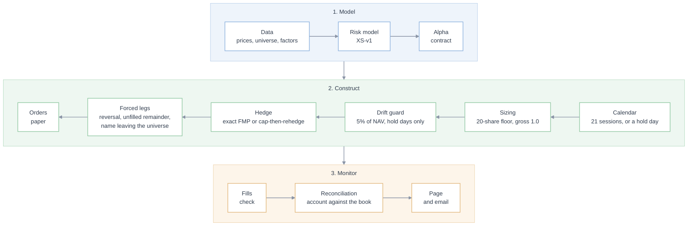

# Equity Factor Book (EFB)

## At a glance

- **What:** a full systematic long/short equity stack built from scratch on free
  data, following Paleologo's APM and EQI: risk models, hedging, sizing,
  transaction costs and ex-post attribution, across thirteen sprints.
- **Live:** a paper-traded book on Alpaca, rebalanced every 21 sessions with a 5%
  drift guard on the hold days between, factor-hedged with a
  factor-mimicking-portfolio hedge, and running on a cron with automated
  reconciliation.
- **How it is built:** two AI agents, one implementing and one reviewing and
  planning, coordinate through handoff files under pre-registered criteria, and
  every headline number is checked against a stored result by a traceability
  test.
- **Where to start:** [`docs/research/STATUS_REPORT.md`](docs/research/STATUS_REPORT.md).
- **What it is not:** a measurement instrument, not a search for an edge. No
  signal here is claimed to have one, and a documented negative result counts as
  a finished piece of work if it prevents a bad decision later.


## What it found, honestly

- **The survivorship cost is real.** Buying today's index members and assuming
  they were always members earns **359.58 bp a year** more than a point-in-time
  universe (E1, F1.5), because only 40.96 percent of deleted members have
  recoverable history against a 70 percent bar.
- **The risk machinery catches a false positive.** The raw idio-momentum
  signal looks significant, with an IC of 0.0125 (t 5.22) at horizon 1, but
  neutralized against the risk model's own factors it is a factor bet in
  disguise: the factor-neutral IC is **-0.0045** (t -0.77) at horizon 21. All
  six candidate signals are NULL once the factors are removed, and the gate said
  so before any of them traded.
- **The champion model is provisional.** XS-v1 wins the pre-registered champion
  rule, but F5.1 failed: no version is calibrated across all portfolio families,
  and the stress haircut is 1.8401.
- **The data layer is measurable even where the edge is not.** The equal-weight
  universe return correlates with the French market return at 0.9573 (E1, F1.3),
  and the survivorship measurement above is the single most consequential number
  the project produced.
- **Equity costs cannot be measured on free data.** Free daily OHLC cannot
  measure spreads for S&P 500 names, so the cost model is an assumption and E9's
  F9.3 is recorded not evaluable rather than failed.
- **The live book is a documented null by design.** It trades idio_momentum
  through the full stack, paper only, so the machinery can be watched on a signal
  whose expected attribution verdict was written down first.

## What running it live taught

- The alpha formula multiplied a **variance where its contract says
  volatility**, tilting the book toward whichever names moved most. Every test
  that checked only a sign or a ranking passed either way (`efb/alpha.py`;
  `docs/research/E11_live_launch.md`).
- A **CTVA spin-off was read as an 83.81 percent crash**, because the price
  vendor does not adjust its history for a spin-off. The research panel now
  corrects the cell from a recorded vendor row (`docs/hygiene_ledger.md`).
- **Broker enumerations arrived as text**, not as the values the code expected.
  The fix parses the text into the enumeration at the boundary and refuses a
  value it does not recognize (`docs/research/E11_live_launch.md`).
- **A warrant entered the universe as a spin-off child.** `SKYD/WS` is the SPY
  holdings file's own warrant line for the same issuer, the vendor filed that
  distribution as a spin-off, and the rule bought a close for a symbol that is not
  a share — replacing SKYD's real -23.84 percent print with +3.13 percent. The
  name was already excluded from the book, so no position moved
  ([`docs/incident_2026-10-15_skyd_spinoff.md`](docs/incident_2026-10-15_skyd_spinoff.md)).
- **The next warrant stopped the run instead.** On 2026-10-14 the price extension
  asked the vendor for `SKYD/WS` alone, got an empty frame, and the frame builder
  assumed its columns existed, so the evening died before sizing. An empty or
  partial download now returns a correctly shaped frame, and the name is dropped
  with its reason ([`docs/incident_2026-10-14.md`](docs/incident_2026-10-14.md)).
- **The pre-hedge reconstruction sized on volatility where the contract says
  variance.** `positions.idio_vol` is a sigma and the sizer divides by its square,
  so every name's weight was multiplied by its own sigma before renormalizing:
  more of the book went to the most volatile names and the "before the hedge"
  volatility was a number no run ever had
  ([`docs/nov11_disposition.md`](docs/nov11_disposition.md), row B4).
- **Realized volatility was measured over the batch the run happened to hold, not
  over the book's history.** An evening that attributed one session gave the
  trailing-quarter window one observation: 2026-10-15 carried 0.226 percent
  against 2.477 percent over its own history, the tenfold cliff the page drew, and
  eight rows carried nothing at all. The window now runs over the history, and a
  repair script restates the stored series
  ([`docs/turn_on_monthly.md`](docs/turn_on_monthly.md)).
- **The evening's cost estimate priced the whole book, not the trade.** Spread and
  commission were summed over |weights|, so the estimate sat at a flat 14.2-14.3 bp
  of NAV whatever the night traded; the flatness was the tell. Spread, commission
  and impact now charge the dollars that actually trade, and only the borrow stays
  on the book ([`docs/turn_on_monthly.md`](docs/turn_on_monthly.md)).
- **A reversal could wait a month.** A sign flip closes tonight and opens on the
  next evening, but on a hold day the published book is the account's book, where
  the name is flat — so the second leg was never sent. A hold day now forces
  whatever the last rebalance left owing: a reversal's second leg, a partial fill,
  a rejection, a name that never filled
  ([`docs/cadence_flag.md`](docs/cadence_flag.md),
  [`docs/turn_on_monthly.md`](docs/turn_on_monthly.md)).
- **An unexplained vendor restatement now excludes the name for the night.**
  CTVA's 6.7x back-adjustment arrived with neither a split record nor a spin-off to
  explain it, and the cross check stopped the run rather than trade a return it
  could not reproduce. The contract is now to drop that name for the session,
  record its ratio, and say so in the email — built and proved on
  `spinoff-explains-adjustment`, merged after the Monday close
  ([`docs/monday_2026-10-26.md`](docs/monday_2026-10-26.md)).

Each of those is a defect the code could not see from the inside, and finding
them meant reading what the system produced rather than what it said.

## The live system



## The live book

The book is a **paper** hedged long/short equity book at a starting NAV of
$1,000,000. It holds the construction row the owner chose, the share-only floor
at 20 whole shares renormalized to gross 1.0, and hedges with a
factor-mimicking-portfolio hedge built on the next session's row. It runs
indefinitely, with a 30-trading-day reporting window that starts on the first
session whose orders filled after the flip. `main` carries the live loop and the
attribution engine that reports on it.

**The calendar.** A rebalance every **21 sessions**, anchored at 2026-10-23 (the
first monthly rebalance, next one 2026-11-23), and a **hold day** in between. A
hold day publishes the book the account holds, so it sends only what last
rebalance left owing: a reversal's second leg, a partial fill or a rejection, a
name that left the universe, a name with no usable close or no risk estimate, a
short the broker will not lend — and the drift guard's own re-hedge when it fires
(`docs/cadence_flag.md`, [`docs/turn_on_monthly.md`](docs/turn_on_monthly.md)).

**The drift guard.** On a hold day the book's worst factor exposure is measured
against the design it will be held with, after the forced legs are placed; past
**5% of NAV** it takes the minimum-norm correction that re-neutralizes it, under
the active hedge mode. The mode is **cap_then_rehedge**: the position cap rounds
first and neutrality is restored after the cap rounds. The manifest records what
the guard measured and what it did, and the page says `hold day, guard re-hedged
6.7% -> 0.0%` when it fires.

**Page.** `docs/img/book_phone.png` is the same document at 390 px: the status
strip and the headline metrics, one swipe in.


**Risk controls.** Every evening reads the account before it sizes anything and
refuses unless the reported account is the one `EFB_ALPACA_ACCOUNT_ID` names,
because EFB's paper keys and another project's sit under one login. An
establishment evening refuses if the account holds anything or has an order
working. Guard 1 caps any position at 0.10 of NAV, re-derived from the target
weight distribution rather than rescaled. The evening run refuses outside
16:00-20:00 New York unless `EFB_FORCE_HOUR` is the exact string `true`, and a
refusal sends a one-line email saying so. A kept name the $250 minimum skips is
a recorded leg, named in the email, that does not make the run incomplete. The
store never falls back on its own: a local run sets `EFB_STORE=local` to read the
parquet files under `live/state/`, and the cron does not, so a missing connection
string there is an error rather than a quiet write to a disk the next container
never sees. The page reads a JSON snapshot and fails loudly when it is late.

**How it is run.** Render runs only the cron jobs. The blueprint `render.yaml`
declares one service, `efb-live-daily`, which starts `scripts/run_cron.py` twice a
weekday, at 15:30 and 22:30 UTC; the hour in New York decides which job runs,
with the morning fills reconciliation before noon and the evening run from 16:00.
The evening extends the panel, fits the model, sizes the book, hedges it, sends
the paper orders and reconciles; the morning checks the fills. Live state stays
in Supabase and the run snapshot goes to a private bucket. The monitor page is a
Cloudflare Worker behind Cloudflare Access, described in `web/README.md`.

**Commands run by hand.**

- The local research console: `make dashboard`, one Streamlit tab per sprint.
- The order-timing smoke test:
  `python scripts/smoke_order_timing.py --symbol SPY --yes`, inside the 16:00 to
  20:00 New York window, submitting one share and cancelling it.
- The weekly review: `PYTHONPATH=. .venv/bin/python scripts/review_week.py`,
  one row per day with the P&L split into factor, idiosyncratic and cost.
- The README screenshots:
  `.venv/bin/python scripts/readme_screenshots.py` builds the page, serves it
  against one snapshot document and rewrites `docs/img/book.png`,
  `docs/img/attribution.png` and `docs/img/book_phone.png`. It defaults to
  `web/fixtures/snapshot_2026-10-13_evening.json`, a real document the evening run
  published; `--snapshot` takes another and `--skip-build` reuses the current
  `dist/`.

## What it costs, and why it rebalances monthly

**Nightly rebalancing was dropped because it is the whole cost.** Rebalancing every
session turns the book over **38.70% of NAV a night**, 97.53 turns a year, for
**624.6 bp a year** of trading cost, against 9.4 turns and 62.4 bp a year for monthly
with no guard at all
([`docs/research/daily_design_study.md`](docs/research/daily_design_study.md)). The
live mode is monthly plus the 5% guard with `cap_then_rehedge`, which turns over
**13.15 times for 86.7 bp a year**. The guard is the whole of the monthly premium: it
costs 23.8 bp and 3.64 of those 13 turns, fires on 24 percent of hold days, and buys a
p95 worst-factor
exposure of **4.76 percent** against **21.71 percent** for the same cadence with no
guard. The 5 percent threshold is a choice with a number behind it: a freshly built
book already carries a ~3.7 percent median exposure to tonight's row, so a 3 percent
bound sits under the noise floor, fires on 46 percent of hold days and costs 4.7 bp
more a year.

**Borrow at 0.35% a year**, not the 2 percent placeholder the model carried until
2026-10-23. General collateral prices at 10 to 35 bp in the public evidence
(index-level 10 bp, value-weighted mean 17 bp, the industry benchmark 30 bp), Alpaca
charges nothing on easy-to-borrow names, and 35 bp sits above the general-collateral
point estimate to carry the hard-to-borrow tail that a single rate cannot see
([`docs/borrow_rate.md`](docs/borrow_rate.md)). On a book that is 50.4 percent short
gross that is 17.6 bp a year of NAV. Tonight's account carries 91 shorts and every
one of them reads `easy_to_borrow`, so the realised bill is zero — the 0.35 percent
is a stress input, and the number that will matter is the first short that turns
hard to borrow, at 20 to 50 percent a year. On the study's own restatement line,
`net = 169 - cost - borrow x (rate / 2%)`, monthly plus guard nets about **+65 bp a
year** at the anchor (169 - 86.7 - 17.6).

**The execution cost measured on paper is not a real cost estimate.** The fills pay
**+17.2 bp against the open** over twelve filled days, 10 of them positive, and all
of it on the buy side (+17.5 bp for buys, -0.6 bp for sells)
([`docs/research/exec_timing.md`](docs/research/exec_timing.md)) — but that is what
this venue's simulator does: paper orders are matched against the best available
quote, the order's size is never checked against the quote's, and a random 10 percent
partial fill is possible, so the number says what the book would pay if the market
always met it at the touch. It is a measurement of the paper account, not of an
equity book, and the study above says as much in its own section on what twelve days
cannot separate. The write-up of the order type that would change it,
`docs/research/moo_orders.md`, is on the held `moo-orders` branch, waiting on the
owner's decision.

## Attribution

The second tab is the attribution: the book's P&L split into the four terms that add
to it — the hedge's factor P&L, the names' idiosyncratic P&L, the cost contribution
and the unexplained remainder — then the predicted volatility before and after the
hedge, the share of predicted variance that is idiosyncratic, and a realized against
forecast panel that refuses to draw a verdict on fewer than thirty live sessions.


The figures come from rows the evening run stores per close, and the page recomputes
the identity from them: on the 2026-10-13 document the four terms close to +0.0 bp of
NAV over nine sessions, with 17 name-days whose residual had to be computed rather
than read
([`docs/research/E12_attribution_report.md`](docs/research/E12_attribution_report.md)).

## Where to look

- **A first look**: this file, then
  [`docs/research/STATUS_REPORT.md`](docs/research/STATUS_REPORT.md), the whole
  project in prose.
- **A quant researcher**: the sprint records under `sprints/E1` to `sprints/E13`
  (`PRD.md`, `TASKS.md`, `RESULTS.json` with every stored number and verdict), the
  research deliverables under [`docs/research/`](docs/research/), and the
  walkthrough notebooks under `notebooks/`, each of which reproduces its sprint's
  numbers, asserts every printed value against the artifact it came from, and
  closes with a "What E11 taught us" section.
- **A portfolio manager**: the live book section above, and
  [`docs/research/E11_live_launch.md`](docs/research/E11_live_launch.md) for how
  it was taken live, from the order that would have gone the wrong way to the
  pre-launch reviews that caught it. Every figure in it is checked back to a
  stored file by `tests/test_e11_live_launch_traceability.py`.
- **A credit desk**:
  [`docs/credit_port_design.md`](docs/credit_port_design.md), what transfers to
  corporate credit unchanged, what has to be re-specified, and the three places
  where unchanged is the wrong answer.
- **The working record**: [`handoff/`](handoff/) holds the standing rules, the
  current task, the reviewer's log and the implementer report.

## Limits

- **Paper trading only.** "Live" here means live data and a continuously running
  loop, never real money.
- **Free data.** Prices and share counts come from a retail vendor, membership
  from a pinned index changes table, factor returns from the French library, and
  sectors from a Wikipedia constituents table. The panel is survivor-only, which
  is measured rather than hidden.
- **No claimed alpha.** No signal survived the RG-Signal gate, the champion model
  is provisional, and equity costs are an assumption. A negative result is a
  complete outcome here.

## Repository map

- `efb/` - the Python package, one module per sprint
- `data/` - the parquet artifacts, with `VERSION.json` carrying their content
  hashes
- `sprints/` - one folder per sprint: PRD, TASKS, RESULTS, PROBES
- `docs/` - the ledgers, research deliverables and standards, and the page
  screenshots under `docs/img/`
- `notebooks/` - the walkthroughs
- `live/` - the paper-trading loop
- `render.yaml` - the Render blueprint: one service, which runs both cron slots
- `scripts/` - the cron entrypoint and the operational scripts
- `handoff/` - the standing rules, the current task and the report

## Setup

```bash
python3.14 -m venv .venv
source .venv/bin/activate
pip install -e ".[dev]"
pre-commit install
make test
```
